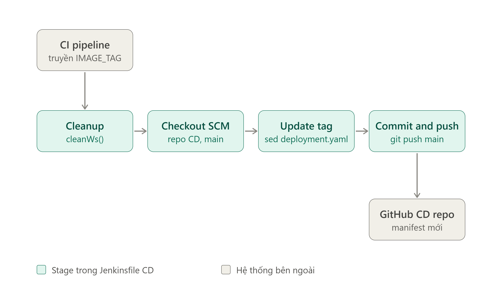
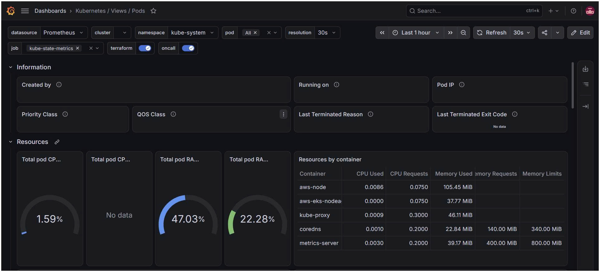

## Grafana, Prometheus & Argo CD on AWS EKS

This guide describes how to create an AWS EKS cluster, deploy Prometheus and Grafana for Kubernetes monitoring, and install Argo CD for GitOps continuous deployment.

### Create AWS EKS Cluster

#### 1. Install kubectl on Jenkins Server

```bash
sudo apt update
sudo apt install -y curl

curl -LO https://dl.k8s.io/release/$(curl -L -s https://dl.k8s.io/release/stable.txt)/bin/linux/amd64/kubectl

sudo install -o root -g root -m 0755 kubectl /usr/local/bin/kubectl

kubectl version --client
```

#### 2. Install AWS CLI

```bash
curl "https://awscli.amazonaws.com/awscli-exe-linux-x86_64.zip" -o "awscliv2.zip"

sudo apt install -y unzip

unzip awscliv2.zip

sudo ./aws/install

aws --version
```

Configure AWS credentials:

```bash
aws configure
```

Provide your AWS Access Key, Secret Access Key, region, and output format.

#### 3. Install eksctl

```bash
curl --silent --location "https://github.com/weaveworks/eksctl/releases/latest/download/eksctl_$(uname -s)_amd64.tar.gz" | tar xz -C /tmp

sudo mv /tmp/eksctl /usr/local/bin

eksctl version
```

#### 4. Create Kubernetes Cluster Using eksctl

```bash
eksctl create cluster \
  --name virtualtechbox-cluster \
  --region ap-south-1 \
  --node-type t2.small \
  --nodes 3
```

#### 5. Verify the EKS Cluster

```bash
kubectl get nodes
kubectl get pods -A
```

---

### C. Setup Kubernetes Monitoring Using Helm, Prometheus and Grafana

#### 1. Install Helm

```bash
curl -fsSL -o get_helm.sh https://raw.githubusercontent.com/helm/helm/master/scripts/get-helm-3

chmod 700 get_helm.sh

./get_helm.sh

helm version
```

#### 2. Add Helm Repositories and Install Prometheus

Add the Helm repositories:

```bash
helm repo add stable https://charts.helm.sh/stable

helm repo add prometheus-community https://prometheus-community.github.io/helm-charts

helm repo update
```

Create the monitoring namespace:

```bash
kubectl create namespace prometheus
```

Install the kube-prometheus-stack:

```bash
helm install stable prometheus-community/kube-prometheus-stack -n prometheus
```

Check the deployed pods:

```bash
kubectl get pods -n prometheus
```

Check Kubernetes services:

```bash
kubectl get svc -n prometheus
```

**Note:** Grafana is included in the `kube-prometheus-stack` Helm chart, so there is no need to install it separately.

#### 3. Expose Prometheus Using LoadBalancer

Edit the Prometheus service:

```bash
kubectl edit svc stable-kube-prometheus-sta-prometheus -n prometheus
```

Change the service type:

```yaml
spec:
  type: LoadBalancer
```

Save and close the editor.

Check the service:

```bash
kubectl get svc -n prometheus
```

Copy the LoadBalancer DNS address and access Prometheus through port `9090`.

#### 4. Expose Grafana Using LoadBalancer

Edit the Grafana service:

```bash
kubectl edit svc stable-grafana -n prometheus
```

Change the service type:

```yaml
spec:
  type: LoadBalancer
```

Save and close the editor.

Check the service:

```bash
kubectl get svc -n prometheus
```

Copy the Grafana LoadBalancer DNS address and open it in your browser.

**Get Grafana Admin Password:**

```bash
kubectl get secret --namespace prometheus stable-grafana \
  -o jsonpath="{.data.admin-password}" | base64 --decode

echo
```

Default username:

```text
admin
```

#### 5. Import Grafana Dashboards

Open Grafana and log in using the admin credentials.

Import the following dashboards:

- Dashboard ID: `15760`
- Dashboard ID: `12740`

For each dashboard:

1. Navigate to **Dashboards → Import**.
2. Enter the Dashboard ID.
3. Click **Load**.
4. Select **Prometheus** as the data source.
5. Click **Import**.

---

### D. Argo CD Installation on Kubernetes Cluster and Add EKS Cluster to Argo CD

Reference: [Argo CD CLI Installation](https://argo-cd.readthedocs.io/en/stable/cli_installation/)

#### 1. Create Argo CD Namespace

```bash
kubectl create namespace argocd
```

#### 2. Install Argo CD

Apply the official Argo CD installation manifest:

```bash
kubectl apply -n argocd \
  -f https://raw.githubusercontent.com/argoproj/argo-cd/stable/manifests/install.yaml
```

#### 3. Verify Argo CD Pods

```bash
kubectl get pods -n argocd
```

Wait until the pods are running.

#### 4. Install Argo CD CLI

```bash
sudo curl --silent --location -o /usr/local/bin/argocd \
  https://github.com/argoproj/argo-cd/releases/download/v2.4.7/argocd-linux-amd64

sudo chmod +x /usr/local/bin/argocd

argocd version --client
```

#### 5. Expose Argo CD Server

Change the Argo CD server service to LoadBalancer:

```bash
kubectl patch svc argocd-server -n argocd \
  -p '{"spec": {"type": "LoadBalancer"}}'
```

#### 6. Get Argo CD LoadBalancer DNS

```bash
kubectl get svc -n argocd
```

Wait for the LoadBalancer external hostname to become available.

Open the Argo CD URL in your browser:

```text
https://<ARGOCD-LOADBALANCER-DNS>
```

#### 7. Get Initial Admin Password

Retrieve the initial admin password:

```bash
kubectl get secret argocd-initial-admin-secret \
  -n argocd \
  -o jsonpath="{.data.password}" | base64 --decode

echo
```

Default username:

```text
admin
```

Log in through the browser and change the initial password.

#### 8. Login to Argo CD Using CLI

```bash
argocd login <ARGOCD-LOADBALANCER-DNS> \
  --username admin
```

Enter the password when prompted.

#### 9. Add EKS Cluster to Argo CD

Get the Kubernetes contexts:

```bash
kubectl config get-contexts
```

Register the EKS cluster:

```bash
argocd cluster add <EKS-CONTEXT-NAME>
```

Verify registered clusters:

```bash
argocd cluster list
```

Argo CD can now manage deployments to the registered Kubernetes cluster.

---


## Jenkins CD pipeline




## Grafana and Prometheus 




## ArgoCD Deployment


